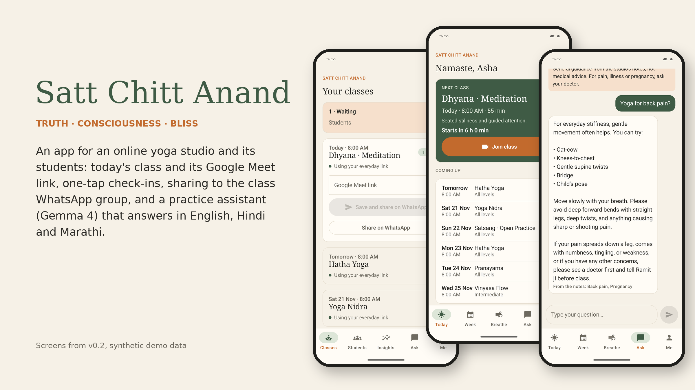
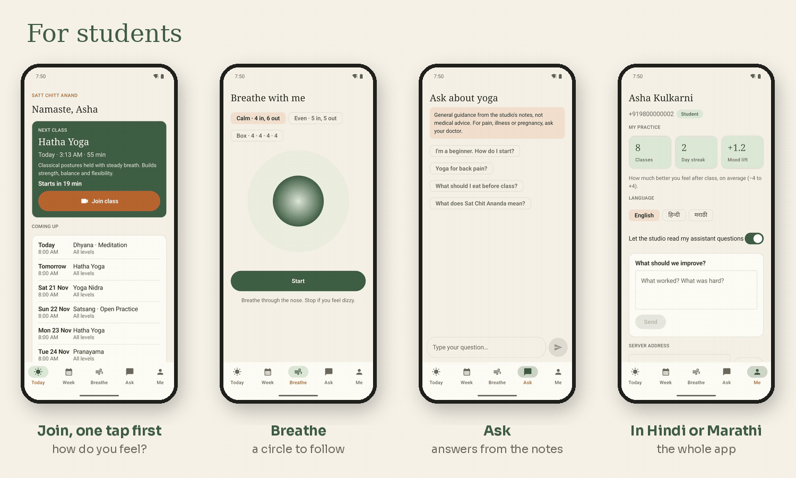
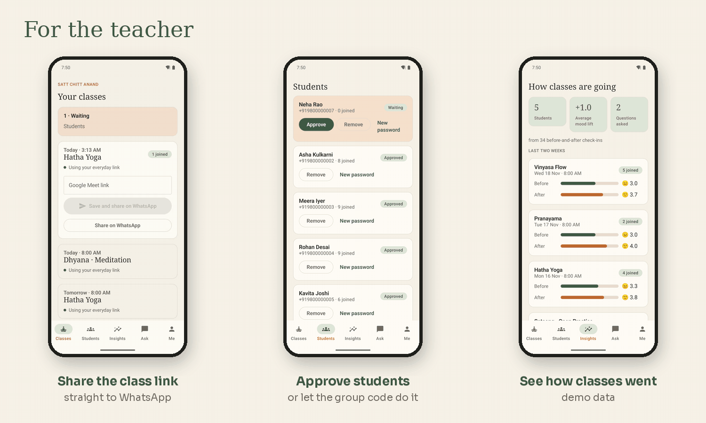
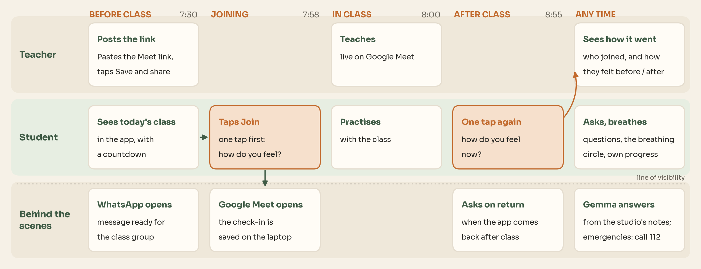
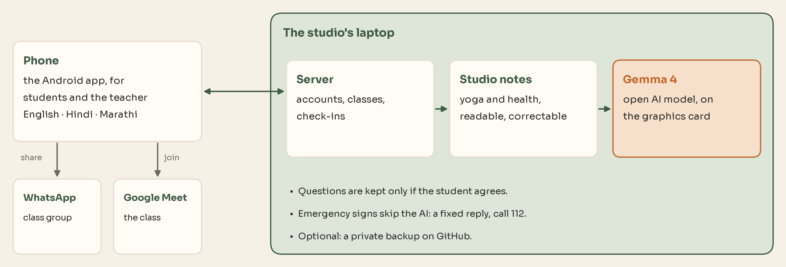
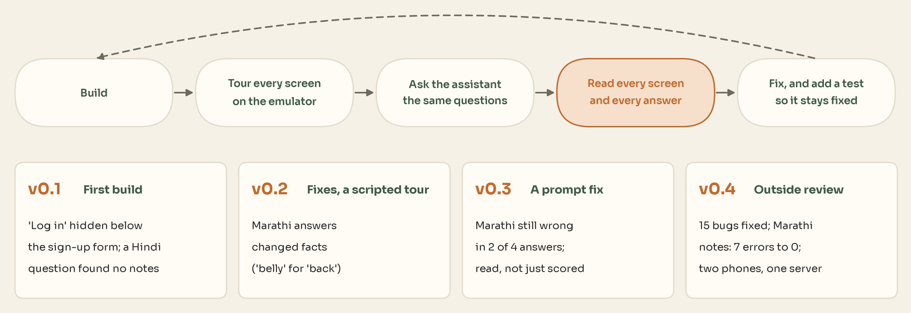

# Satt Chitt Anand

An Android app for an online yoga studio, its teacher and its students.



**[▶ Watch the three-minute tour](docs/media/video/satt_chitt_anand_tour_720p.mp4)** (narrated, with captions) ·
[What it does](#what-it-does) · [How it was made](#how-it-was-made) · [Try it](#try-it)

## The brief

A teacher runs a live class every morning on Google Meet for a class of about ten students, who keep in touch in one
WhatsApp group. The app had to fit around that, not replace it:

- the day's class and its link one tap away, without scrolling back through the group;
- the teacher shares the link once, in the group where the class already talks;
- everyday questions about practice and health answered in the student's own language, without the app ever acting
  as a doctor.

## What it does



- **Ask knows your practice.** "How was my practice this week?" gets the student's own classes and moods; "Which
  class suits me tomorrow?" checks the schedule; "Remember that my knee hurts" is kept for later.




## A morning with the app



## Design choices

- **Keep WhatsApp where it is.** The app does not read the group. The teacher shares into it from the app, and a group
  code posted there lets students in.
- **One tap, no reading.** Five faces before and after class; a breathing circle that grows and shrinks.
- **The students' own languages.** Screens, class names and answers in English, Hindi and Marathi.
- **Careful with health.** The assistant answers only from notes the studio can read and correct. It never diagnoses or
  touches medicines, and emergency signs get a fixed reply pointing to 112, with no AI involved.
- **Code does the sums.** The assistant looks up only the signed-in student's own data, through tools that hand it
  totals and averages worked out in code, so a small model never has to add up rows.
- **Ask before sharing anything.** A student's chat and what the assistant remembers are theirs: the teacher cannot
  see them and they are not in the studio's backup. The studio sees the words of a question only if they agree.

Each choice, with the alternatives considered: [`docs/decisions.md`](docs/decisions.md).

## How it works



An Android app, and a small server on the studio's laptop. The assistant is **Gemma 4**, an open model that runs on the
laptop's graphics card, so questions do not go to an outside AI service.

## How it was made



Five rounds so far. Each round, a script walks through every screen on an Android emulator, and the assistant is asked
the same questions in three languages. Then every screen and every answer is read, as a student would. Two things the
first tour caught:


The hardest finding came from reading, not scoring: Marathi answers passed every automatic check, yet some changed
the facts, such as "avoid lying on the belly" where the notes say "on the back". Giving the assistant notes written in
Marathi, instead of letting it translate, brought those errors from seven to none.

The full record: [iteration log](docs/iterations/README.md) · [assistant evaluations, every answer](docs/evals/) ·
[design decisions](docs/decisions.md).

## Try it

On the laptop that holds the toolchain:

```bash
scripts/demo.sh two     # the server, two phones, and the app; scripts/demo.sh stop to finish
```

Password `demo123`: teacher `9800000001`, students `9800000002` to `9800000006`. Setup, tests, tours and the video:
[`docs/DEVELOPMENT.md`](docs/DEVELOPMENT.md).

## Credits

Designed and directed by **Dhwani Mundra**: the brief, the product decisions, and every round of critique and changes.
The code, tours and evaluations were written with **Claude Code**, an AI coding agent, working from her direction.
Studio content: Satt Chitt Anand Yoga Classes, Ramit M Tippannavar.
