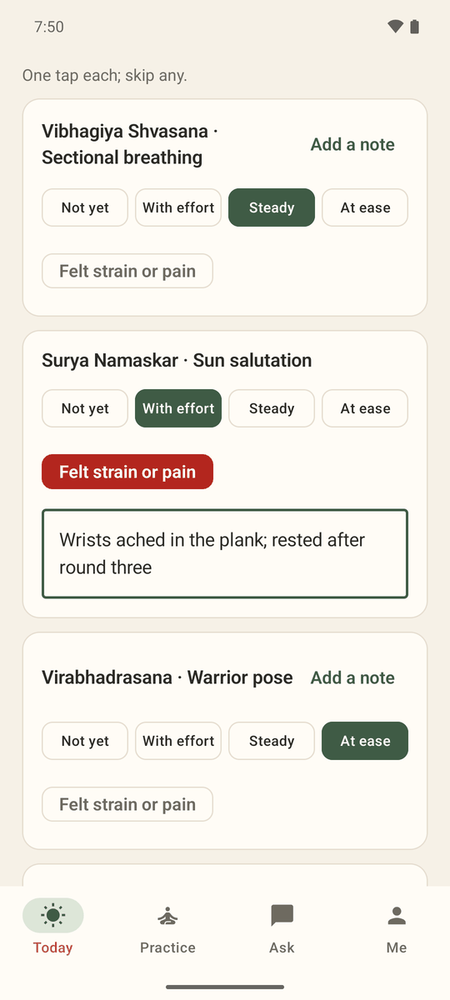
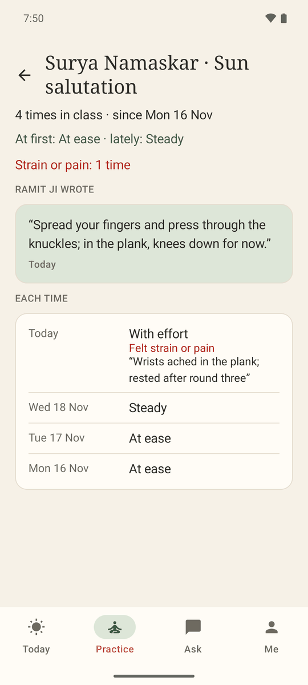
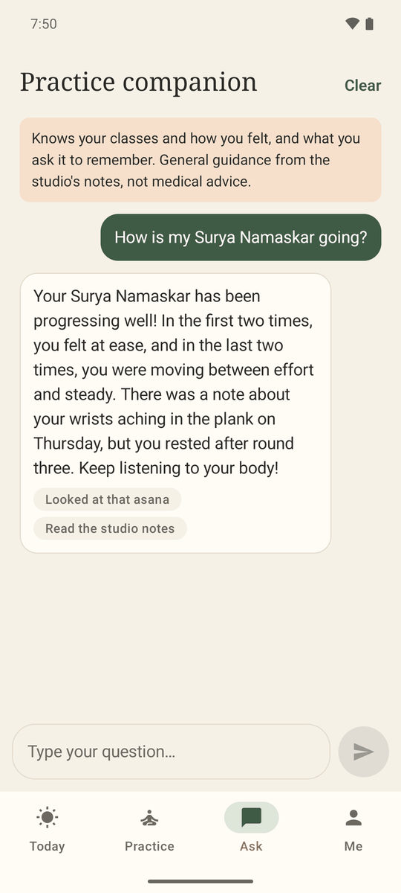
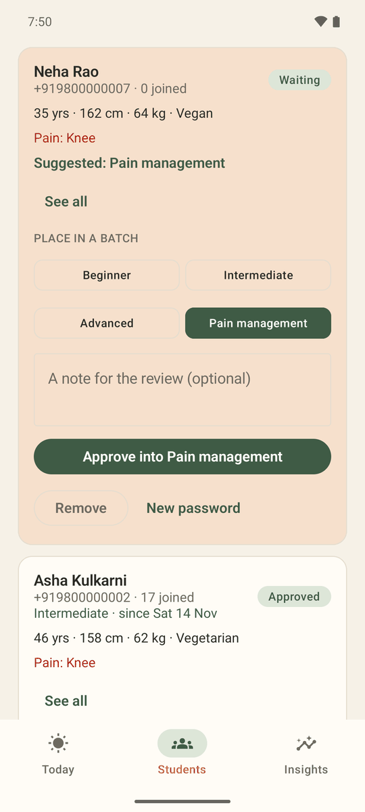
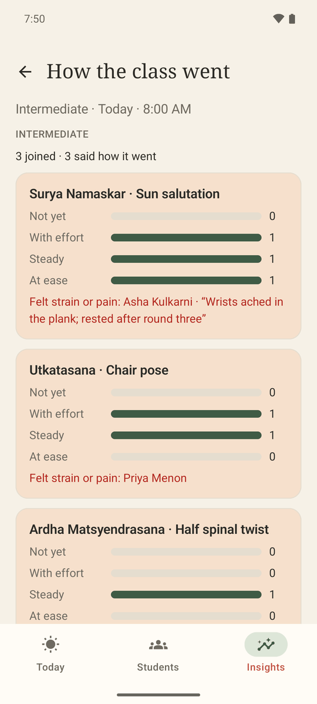
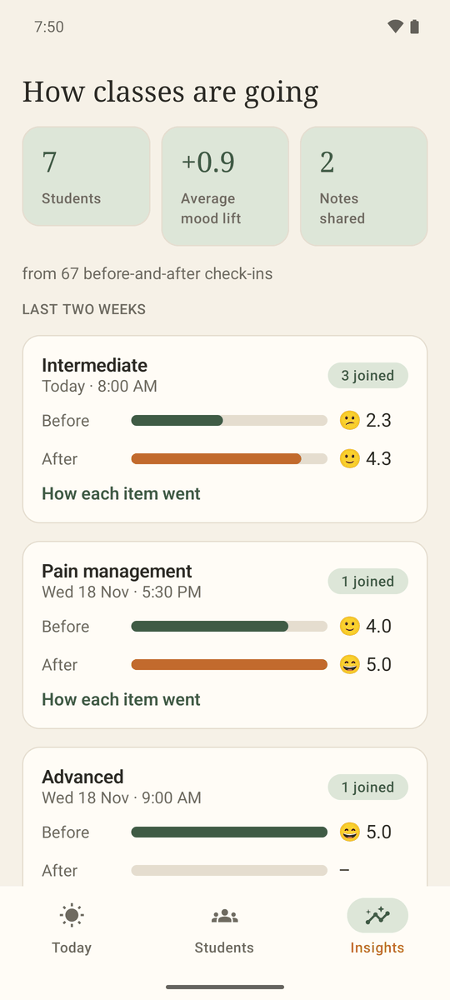
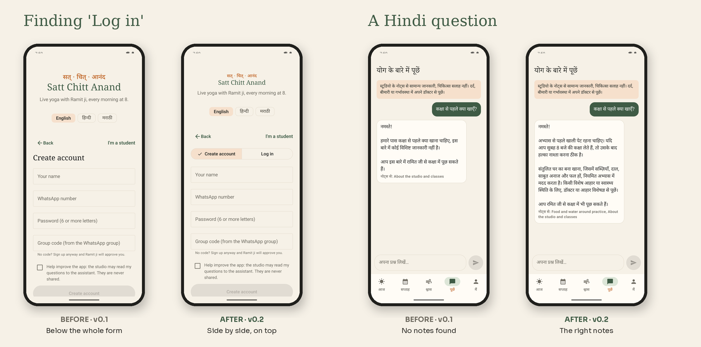
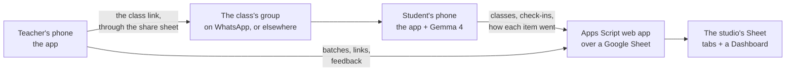

# Satt Chitt Anand

A practice tracker for an online yoga studio: students say how each asana went, in class and on their own, and the
teacher reads it to guide them.

**[Watch the 2:43 film of how it works](https://github.com/DhwaniMundra/satt_chitt_anand_yoga/releases/download/v0.9.1/satt_chitt_anand_film_720p.mp4)**

<!-- Dhwani: your own sentences go here. -->

## The studio and the problem

One teacher teaches live on Google Meet, in four batches: Beginner, Intermediate, Advanced, and Pain management for
knee, back and neck pain. The teacher guides each body safely, and a strain or a pain is the signal not to miss.
Students should be able to see their own progress, in English, Hindi or Marathi, and keep their health private.

A Meet call and a chat group run the class but keep little of it: the link gets buried in the chat, how each pose felt
goes unsaid, and nothing is remembered from week to week. The app keeps that record.

## What it does

<p>
  
  
  
  
</p>

**For a student**
- **Joining:** a phone number, the group code, and a few questions for the teacher, who places them in a batch.
- **The Today tab:** the next class in their own time zone, with its sequence and Meet link; after class, one tap per
  item and a flag for strain or pain.
- **The Practice tab:** how each asana has gone, in class and alone, and what the teacher wrote; a stopwatch for
  practice on one's own.
- **The Ask tab:** Gemma 4 on the phone, answering from their own practice and the studio's notes: "How is my Setu
  Bandhasana going?"

<p>
  
  
  
  
</p>

**For the teacher**
- **The Today tab:** a card per batch with the class's sequence and Meet link, to share anywhere.
- **The Students tab:** a new student's answers and the batch they point to; placing and moving students; feedback on
  any asana.
- **The Insights tab:** mood before and after each class, and how each class went, strain or pain first.

## Design decisions

| Choice | Why |
|---|---|
| **One tap per item:** not yet, with effort, steady or at ease, plus a flag for strain or pain | Seconds after class, in words a student would use. Strain leads the class review |
| **A privacy split.** The Gemma chat and health notes stay on the phone; check-ins, moods, reactions, notes on items, a new student's answers and the teacher's feedback go to the studio's Sheet | The teacher needs the practice record. A health note leaves the phone only if its student shares it |
| **Gemma on the phone:** Gemma 4 E2B, a 2.6 GB opt-in download, with tools that see one student's data and do the sums in code | Questions never leave the phone. E2B matched the larger E4B. Left to add up rows itself, Gemma once got the sum wrong |
| **A Google Sheet as the backend**, under an Apps Script web app | Free, with nothing to run, and every table is a tab the studio can read and correct |
| **WhatsApp as one way to share.** A phone number is the account; shares go through Android's share sheet | The studio asked: a student may not use WhatsApp, and a class may keep in touch elsewhere |
| **The streak counted in classes** of the student's batch | Batches do not meet daily. Counted in days, a Mon, Wed, Fri student never had a streak above 1 |

Every decision, with the options considered: [`docs/decisions.md`](docs/decisions.md).

## How it changed

Each round, a script tours the app on an emulator and asks Gemma the same questions in three languages. Every screen
and answer is read, and each finding is fixed, with a test where one fits.

| Round | What changed |
|---|---|
| v0.1 to v0.3 | A class app from the brief: Meet links shared to WhatsApp, moods before and after, Gemma on the studio's notes |
| v0.4 | An independent code review, Marathi notes, two phones on one server |
| v0.5, v0.6 | The Ask tab becomes a practice companion, and Gemma moves onto the phone |
| v0.7 | The backend moves from a laptop to a Google Sheet |
| v0.9 | The practice tracker, released for testing |
| v0.9.1 | Works without WhatsApp; the fixes from two reviews and a two-phone test |



Findings that changed the design:
- **Every answer is read.** In v0.2 all 17 answers passed the automatic checks, yet Marathi ones changed facts ("belly"
  for "back"). In v0.4, notes written in Marathi took the changed facts from 7 to 0.
- **Averages in words.** Gemma read an average of 2.0 ("with effort") as "not yet". Its tools now hand it the
  words, worked out in code.
- **A backend the studio can read.** The laptop server needed the laptop on; v0.7 moved to a Sheet once 101 requests
  got the same answers from both.
- **Testing the release.** After v0.9, an independent review found class times typed in the Sheet read eight minutes
  late, among other things, and a two-phone test ran the loop without WhatsApp. With the studio's request to work
  without it, this became v0.9.1: 131 of 131 checks on two phones.

The record: [iteration log](docs/iterations/README.md) · [evaluations, every answer](docs/evals/) ·
[decisions](docs/decisions.md) · [development](docs/DEVELOPMENT.md).

## The field test

From late November 2026, the teacher and the first students use v0.9.1 in class, with their consent. The studio's
Sheet records what the app is for (attendance, moods, how each item went, strain or pain, notes on items, practice
alone, the teacher's feedback), to learn whether the record helps the teacher guide each student and what to change
next. The Gemma chat stays on the phones, and so do health notes unless a student shares one. Results will be added
here.

## How it works



- **The backend** is an Apps Script web app over a Google Sheet in the studio's Drive
  ([`appsscript/`](appsscript/README.md)).
- **Gemma 4 E2B runs on the phone.** Its tools hand it only that student's data, with the sums done in code. A phone
  with too little memory is told so.

## Careful with health

- Gemma never diagnoses, promises a cure or advises on medicine. Emergency signs get a fixed reply with 112 and
  Tele-MANAS (14416) before any model runs.
- What a student says about themselves is for them and the teacher; the Sheet's Dashboard shows it only as counts.
- Every answer in the evaluation was read against the data ([`companion_v0.9_phone`](docs/evals/companion_v0.9_phone.md)).
  Marathi is the weak spot; a Marathi reader checks it.

## Try it

The app for Android is on the [v0.9.1 release page](https://github.com/DhwaniMundra/satt_chitt_anand_yoga/releases/tag/v0.9.1).
To run everything on the laptop that holds the toolchain:

```bash
scripts/demo.sh         # the dev backend on demo data, the 6 GB emulator with Gemma, and the app; demo.sh stop ends it
```

Password `demo123`: the teacher `9800000001`; students `9800000002` to `9800000006` and `9800000008`; `9800000007` is
waiting to be placed. The demo's people and practice are synthetic.

## Credits

Designed and directed by **Dhwani Mundra**: the brief, the product decisions, and every round of critique and changes.
The code, tours and evaluations were written with **Claude Code**, an AI coding agent, working from her direction.
Studio content: Satt Chitt Anand Yoga Classes.
