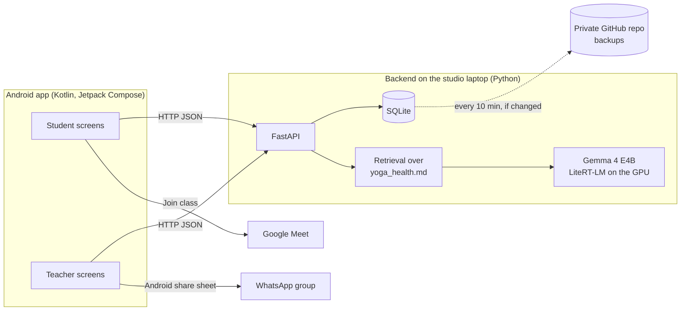

# Satt Chitt Anand

An Android app for an online yoga studio and its students. The students see today's class and join it on Google
Meet in one tap; the teacher posts the class link to the class WhatsApp group from the app; and a practice assistant
built on **Gemma 4** answers questions about yoga and everyday health in **English, Hindi and Marathi**, from notes
the studio can read and correct.


<p>
  
  &nbsp;
  
</p>

**Two phones, one server:** the teacher (left) posts the class link; a student (right) joins, checks in before and
after class, and asks the assistant; then a new student waits for approval until the teacher approves.


*Screens and recordings use synthetic demo data and test people. Full recordings:
[student](docs/media/v0.4/student_tour_small.mp4), [teacher](docs/media/v0.4/teacher_tour_small.mp4),
[two phones](docs/media/v0.4-two-phones/two_phones.mp4).*

## What it does

**For students**
- **Today:** the next class, a countdown, and **Join class**. Joining asks one question first, "How do you feel
  right now?", answered with one of five faces; after class it asks again.
- **Week:** the weekly rhythm (Hatha, Pranayama, Vinyasa, Dhyana, Yoga Nidra, Satsang) and the teacher.
- **Breathe:** a circle that grows as you breathe in and shrinks as you breathe out, in three rhythms. It follows
  the eye, so it needs no reading.
- **Ask:** questions about practice and everyday health, answered by Gemma 4 from the studio's notes, with the notes
  it used listed under each answer. It never diagnoses or touches medicines, and emergencies get an immediate
  reply with India's emergency number (112) without the model.
- **Me:** classes joined, days in a row, average mood lift after class; language; consent; feedback.

**For the teacher**
- **Classes:** paste the Google Meet link, then **Save and share on WhatsApp** opens WhatsApp with the message
  ready for the group. An everyday link can cover every class.
- **Group code:** a short code to post in the WhatsApp group. Students who sign up with it are approved at once;
  others wait for the teacher's approval.
- **Students:** approve, remove, or give a new password.
- **Insights:** how many joined each class and how they felt before and after; what students wrote.

## How it works



- **Why the app does not read the WhatsApp group:** there is no supported way to, and the unofficial libraries
  break WhatsApp's terms and can get the teacher's number banned. The teacher shares from the app instead, and the
  group code stands in for group membership. All decisions, with the options considered:
  [`docs/decisions.md`](docs/decisions.md).
- **The assistant's knowledge** is one file (with a Marathi version, see below), [`backend/knowledge/yoga_health.md`](backend/knowledge/yoga_health.md):
  about 25 short sections, each with keywords in English, Hindi and Marathi. The best-matching sections go into
  Gemma's instructions with rules: answer only from the notes, never diagnose or change medicines, send people to
  their doctor and the teacher, and reply in the student's language. For Marathi, Gemma 4 E4B translating on the fly
  changed facts, so Marathi questions get the matching sections of
  [`yoga_health.mr.md`](backend/knowledge/yoga_health.mr.md), which it copies
  ([how that was decided](docs/iterations/v0.4.md#2-marathi-answers)).

## How it was iterated

Each version is built, toured on the emulator by a script, evaluated, and critiqued screen by screen and answer by
answer; v0.4 added an independent code review. The findings drive the next version. The log, with before-and-after images:
[`docs/iterations/`](docs/iterations/README.md). Assistant evaluations, with every answer in full:
[`docs/evals/`](docs/evals/).

| Before | After |
|---|---|
|  |  |

## Run it

Linux with an NVIDIA GPU. The toolchain (JDK 21, Android SDK, emulator image) and the model live in `tools/` and
`models/`, which git ignores.

**A demo, in one command**
```bash
scripts/demo.sh          # server with Gemma on demo data, an emulator, the app open
scripts/demo.sh two      # a second phone: teacher on one, student on the other
scripts/demo.sh stop
```
Logins, password `demo123`: teacher `9800000001`; students `9800000002`–`9800000006`; `9800000007` is waiting for
approval.

**Step by step**

```bash
source scripts/env.sh                  # points java, adb and the emulator at tools/
scripts/run_backend.sh                 # API on :8000, Gemma loads in the background (SCA_GEMMA=off to skip)
scripts/build_app.sh                   # android/app/build/outputs/apk/debug/app-debug.apk
scripts/run_emulator.sh                # boots tools/avd/sca_phone
adb install -r android/app/build/outputs/apk/debug/app-debug.apk
```

The server prints the **teacher sign-up code** when it starts (or set `SCA_TEACHER_CODE`). The emulator reaches the
laptop at `http://10.0.2.2:8000`. A phone on the same Wi-Fi needs the laptop's address: build with
`scripts/build_app.sh -PscaServer=http://<laptop IP>:8000`, or change **Server address** on the first screen.

**Demo data and media**
```bash
cd backend && .venv/bin/python -m scripts.seed_demo ../data/demo.sqlite3 && cd ..
SCA_DB=$PWD/data/demo.sqlite3 scripts/run_backend.sh
python3 scripts/capture_tour.py v0.5 data/demo.sqlite3   # screenshots + recordings into docs/media/v0.5/
python3 scripts/make_figures.py
# two phones (second emulator: SCA_AVD=sca_phone_2 SCA_PORT=5556 scripts/run_emulator.sh), fresh database:
python3 scripts/two_phone_test.py v0.5-two-phones http://10.0.2.2:8000 data/two_phones.sqlite3 <teacher code>
```

**Tests and evaluation**
```bash
cd backend && .venv/bin/python -m pytest -q                       # API, retrieval, safety path, backup
.venv/bin/python -m scripts.eval_assistant ../docs/evals/next.md  # needs the GPU free: stop the server first
```

**Backups** (optional): create a private GitHub repository and a fine-grained token with read and write access to its
contents, then set `SCA_BACKUP_REPO=owner/name` and `SCA_GITHUB_TOKEN=…` before starting the server. An empty server
restores from the last backup.

### Setting up a fresh machine

`tools/` and `models/` were copied from an existing setup. On a new machine (not yet scripted):
1. JDK 21 (for example Eclipse Temurin) into `tools/jdk`.
2. Android command-line tools into `tools/android-sdk/cmdline-tools/latest`, then
   `sdkmanager "platform-tools" "emulator" "platforms;android-36" "build-tools;36.0.0" "system-images;android-36;google_apis_playstore;x86_64"`.
3. `avdmanager create avd -n sca_phone -k "system-images;android-36;google_apis_playstore;x86_64" -d pixel_6`
   with `ANDROID_AVD_HOME=tools/avd`.
4. `gemma-4-E4B-it.litertlm` from Hugging Face (`litert-community/gemma-4-E4B-it-litert-lm`) into
   `models/gemma-4-E4B-it/`.
5. `cd backend && uv venv .venv && uv pip install -e ".[dev]"`.

## Layout

| Path | Contents |
|---|---|
| `android/` | The app: `Data.kt` (HTTP and models), `AppViewModel.kt`, `ui/` (screens), strings in `res/values{,-hi,-mr}` |
| `backend/sca/` | `app.py` (API), `db.py`, `auth.py`, `studio.py` (classes and sessions), `whatsapp.py`, `assistant.py`, `backup.py` |
| `backend/knowledge/` | The assistant's notes |
| `backend/content/studio.json` | Classes, weekly rhythm, teacher, in three languages |
| `backend/evals/`, `backend/scripts/` | Assistant question set and evaluation; demo data |
| `scripts/` | Environment, build, emulator, `demo.sh`, the capture tour, the two-phone test, figures |
| `docs/` | Decisions, iteration log, evaluations, media |

## Status and limits

- **A prototype for demos.** Not used by real students. All Hindi and Marathi text, including the Marathi notes the
  assistant copies, is an AI-drafted translation awaiting a native speaker's reading.
- The server runs on a laptop over plain HTTP: fine on the emulator and home Wi-Fi, not for students elsewhere.
- Studio name, schedule and teacher bio come from the studio's public site; confirm with the studio before
  publishing.
- The assistant gives general guidance from the studio's notes. It is not medical advice.

## Credits

Brief and product direction: Dhwani Mundra. Engineering: Vibhakar Mohta, with Claude Code (an AI coding agent),
which wrote most of the code in v0.1–v0.4. Studio content: Satt Chitt Anand Yoga Classes, Ramit M Tippannavar.
