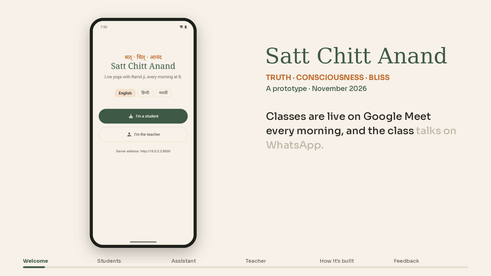
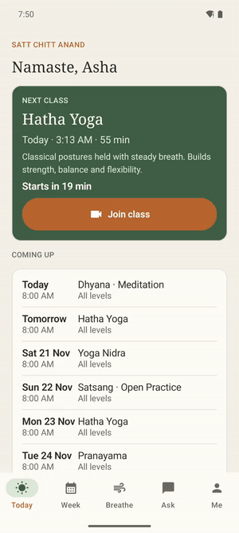
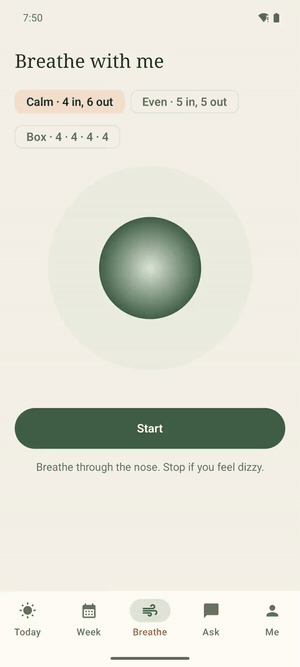
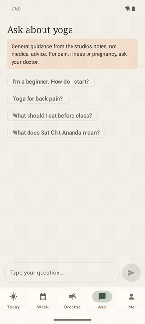
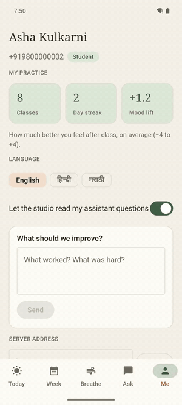
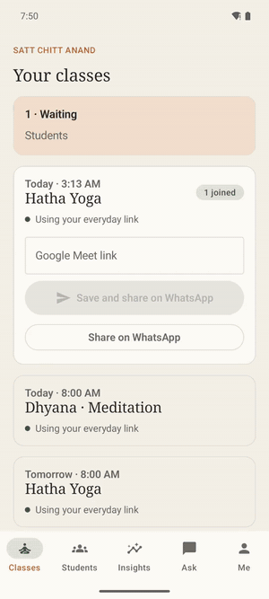
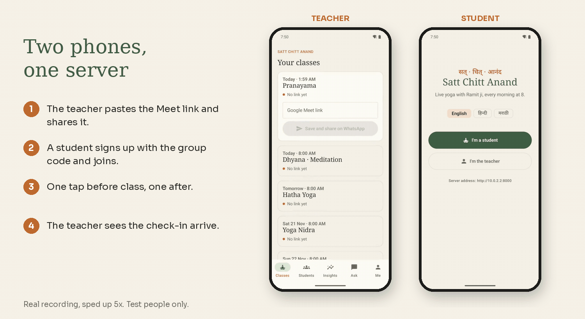
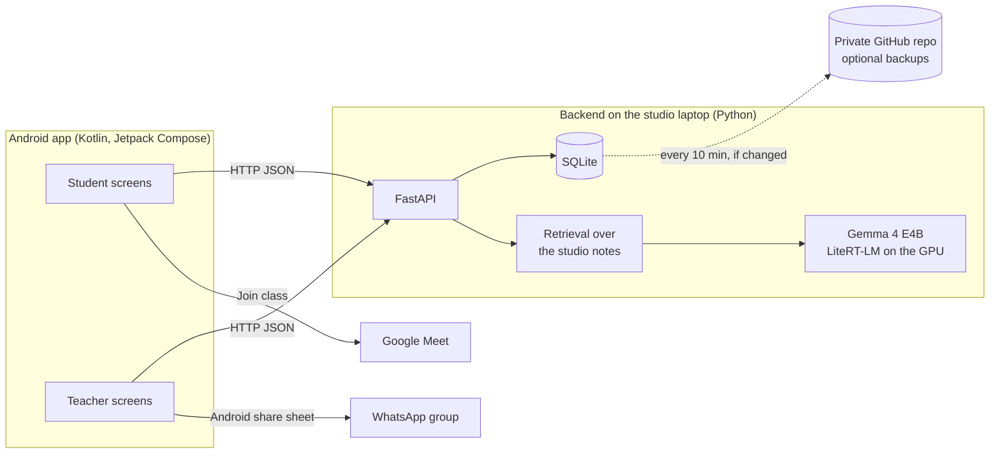
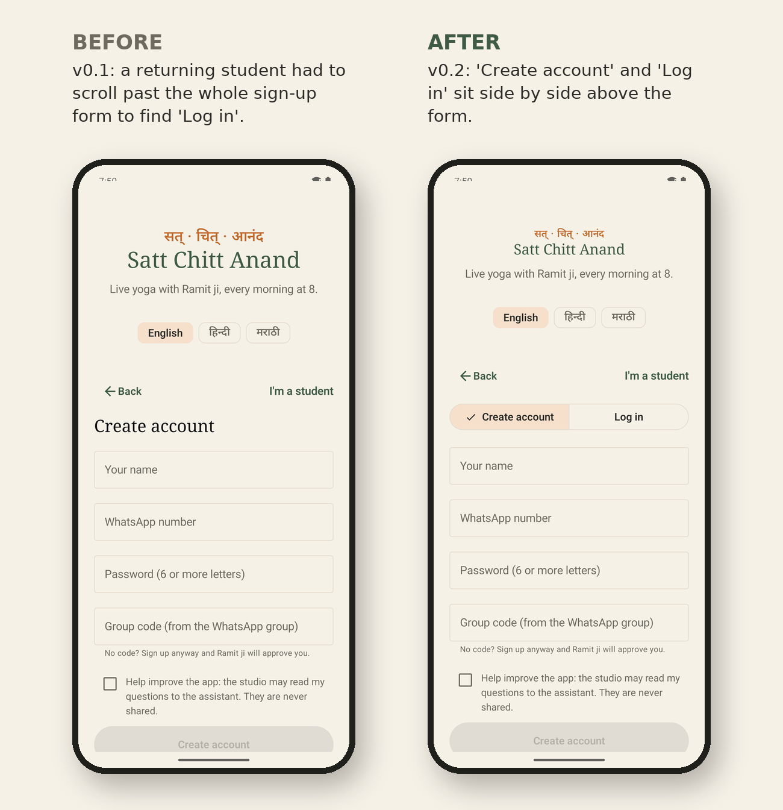
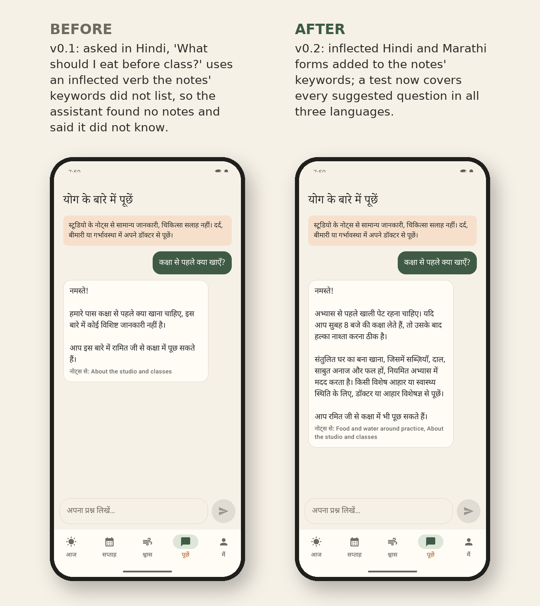

# Satt Chitt Anand

An Android app for an online yoga studio and its students. Students see today's class and join it on Google Meet in
one tap. The teacher posts the class link to the class WhatsApp group from the app. A practice assistant built on
**Gemma 4** answers questions about yoga and everyday health in **English, Hindi and Marathi**, from notes the studio
can read and correct.


## Watch it

**A narrated three-minute tour**, made to share and ask for feedback:
[watch the video](docs/media/video/satt_chitt_anand_tour_720p.mp4) ·
[captions](docs/media/video/satt_chitt_anand_tour.srt)

[](docs/media/video/satt_chitt_anand_tour_720p.mp4)

| Join, with a one-tap check-in | Breathe with the circle | Ask the assistant |
|:---:|:---:|:---:|
|  |  |  |
| **The whole app in Hindi** | **The teacher shares the Meet link** | |
|  |  | |

**Two phones, one server:** the teacher (left) posts the link; a student (right) signs up with the group code, joins,
checks in before and after class, and asks a question; the teacher sees the check-in arrive.



*All screens use synthetic demo data and test people.*

## What it does

**For students**
- **Today:** the next class, a countdown, and **Join class**. Joining asks one question first, "How do you feel
  right now?", answered with one of five faces; after class it asks again.
- **Week:** the studio's rhythm (Hatha, Pranayama, Vinyasa, Dhyana, Yoga Nidra, Satsang) and the teacher.
- **Breathe:** a circle that grows as you breathe in and shrinks as you breathe out. It needs no reading.
- **Ask:** questions about practice and everyday health, answered from the studio's notes, with the notes it used
  listed under each answer. It never diagnoses or touches medicines; emergencies get an immediate reply with India's
  emergency number (112), without the model.
- **Me:** classes joined, days in a row, average mood lift after class; language; consent; feedback.

**For the teacher**
- **Classes:** paste the Google Meet link, then **Save and share on WhatsApp** opens WhatsApp with the message ready.
- **Group code:** posted in the WhatsApp group; students who sign up with it are approved at once, others wait.
- **Students:** approve, remove, or give a new password.
- **Insights:** who joined each class and how they felt before and after; what students wrote.

## How it works



- **The app does not read the WhatsApp group:** there is no supported way to, and the unofficial libraries break
  WhatsApp's terms and can get the teacher's number banned. The teacher shares from the app, and the group code stands
  in for group membership. Every decision, with the options considered: [`docs/decisions.md`](docs/decisions.md).
- **The assistant's knowledge** is one notes file, [`backend/knowledge/yoga_health.md`](backend/knowledge/yoga_health.md),
  with a Marathi version. The best-matching sections go into Gemma's instructions with rules: answer only from the
  notes, never diagnose or change medicines, send people to their doctor and the teacher, reply in the student's
  language. For Marathi, Gemma 4 E4B translating on the fly changed facts, so it copies notes written in Marathi
  instead ([how that was decided](docs/iterations/v0.4.md#2-marathi-answers)).

## How it was built: in small rounds

Each version is built, toured on the emulator by a script, evaluated, and critiqued screen by screen and answer by
answer; v0.4 added an independent code review. The findings drive the next version. The log:
[`docs/iterations/`](docs/iterations/README.md) · assistant evaluations with every answer:
[`docs/evals/`](docs/evals/).

| Before → after: finding "Log in" | Before → after: a Hindi question the assistant missed |
|---|---|
|  |  |

## Run it

Linux with an NVIDIA GPU. The toolchain (JDK 21, Android SDK, emulator image) and the model live in `tools/` and
`models/`, which git ignores.

**A demo, in one command**
```bash
scripts/demo.sh          # server with Gemma on demo data, an emulator, the app open
scripts/demo.sh two      # a second phone: teacher on one, student on the other
scripts/demo.sh stop
```
Logins, password `demo123`: teacher `9800000001`; students `9800000002`–`9800000006`; `9800000007` is waiting for
approval.

**Step by step**
```bash
source scripts/env.sh                  # points java, adb and the emulator at tools/
scripts/run_backend.sh                 # API on :8000, Gemma loads in the background (SCA_GEMMA=off to skip)
scripts/build_app.sh                   # android/app/build/outputs/apk/debug/app-debug.apk
scripts/run_emulator.sh                # boots tools/avd/sca_phone
adb install -r android/app/build/outputs/apk/debug/app-debug.apk
```
The server prints the teacher sign-up code when it starts (or set `SCA_TEACHER_CODE`). The emulator reaches the laptop
at `http://10.0.2.2:8000`. A phone on the same Wi-Fi needs the laptop's address: build with
`scripts/build_app.sh -PscaServer=http://<laptop IP>:8000`, or change **Server address** on the first screen.

**Tests and the assistant evaluation**
```bash
cd backend && .venv/bin/python -m pytest -q                        # 69 tests
.venv/bin/python -m scripts.eval_assistant ../docs/evals/next.md   # needs the GPU free: stop the server first
```

**Tours, media and the video** (raw output stays in `.local/visualization/`, which git ignores)
```bash
cd backend && .venv/bin/python -m scripts.seed_demo ../data/demo.sqlite3 && cd ..
SCA_DB=$PWD/data/demo.sqlite3 scripts/run_backend.sh
python3 scripts/capture_tour.py v0.5 data/demo.sqlite3     # screenshots and recordings of one version
python3 scripts/make_figures.py                            # the curated media in docs/media/
scripts/setup_media.sh                                     # once: tools/media-venv with Kokoro-82M
tools/media-venv/bin/python scripts/make_video.py          # the narrated video
```

**Backups** (optional): a private GitHub repository and a fine-grained token with read and write access to its
contents; set `SCA_BACKUP_REPO=owner/name` and `SCA_GITHUB_TOKEN=…` before starting the server.

### Setting up a fresh machine

`tools/` and `models/` were copied from an existing setup. On a new machine (not yet scripted):
1. JDK 21 (for example Eclipse Temurin) into `tools/jdk`.
2. Android command-line tools into `tools/android-sdk/cmdline-tools/latest`, then
   `sdkmanager "platform-tools" "emulator" "platforms;android-36" "build-tools;36.0.0" "system-images;android-36;google_apis_playstore;x86_64"`.
3. `avdmanager create avd -n sca_phone -k "system-images;android-36;google_apis_playstore;x86_64" -d pixel_6`
   with `ANDROID_AVD_HOME=tools/avd`.
4. `gemma-4-E4B-it.litertlm` from Hugging Face (`litert-community/gemma-4-E4B-it-litert-lm`) into
   `models/gemma-4-E4B-it/`.
5. `cd backend && uv venv .venv && uv pip install -e ".[dev]"`.

## Where things are

| Path | What it is |
|---|---|
| `android/` | The app: `Data.kt` (HTTP and models), `AppViewModel.kt`, `ui/` (one file per screen), text in `res/values{,-hi,-mr}` |
| `backend/sca/` | The server: `app.py` (API), `db.py`, `auth.py`, `studio.py`, `whatsapp.py`, `assistant.py`, `backup.py` |
| `backend/knowledge/` | The assistant's notes, in English and Marathi |
| `backend/content/studio.json` | Classes, weekly rhythm and teacher, in three languages |
| `backend/tests/`, `backend/evals/` | Tests; the assistant's question set |
| `scripts/` | Run it (`demo.sh`, `run_backend.sh`, `build_app.sh`, `run_emulator.sh`), tour it (`capture_tour.py`, `two_phone_test.py`), and make media (`make_figures.py`, `make_video.py`) |
| `docs/` | `decisions.md`, `iterations/` (the log), `evals/` (every answer), `media/` (the images, GIFs and video above) |
| `.local/visualization/` | *Not committed.* Watchable recordings on top; raw screenshots in `tours/`; build files in `work/` |
| `data/`, `tools/`, `models/` | *Not committed.* Databases; toolchain; the Gemma model |

## Status and limits

- **A prototype for demos.** Not used by real students. All Hindi and Marathi text, including the Marathi notes the
  assistant copies, is an AI-drafted translation awaiting a native speaker's reading.
- The server runs on a laptop over plain HTTP: fine on the emulator and home Wi-Fi, not for students elsewhere.
- Studio name, schedule and teacher bio come from the studio's public site; to be confirmed with the studio.
- The assistant gives general guidance from the studio's notes. It is not medical advice.

## Credits

Designed and directed by **Dhwani Mundra**: the brief, the product decisions, and every round of critique and changes.
The code, tours and evaluations were written with **Claude Code**, an AI coding agent, working from her direction.
The Android toolchain and the on-device Gemma setup were reused from Vibhakar Mohta's `mobile_use_agent` project.
Studio content: Satt Chitt Anand Yoga Classes, Ramit M Tippannavar.
