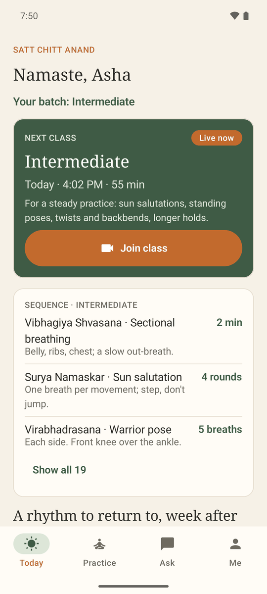
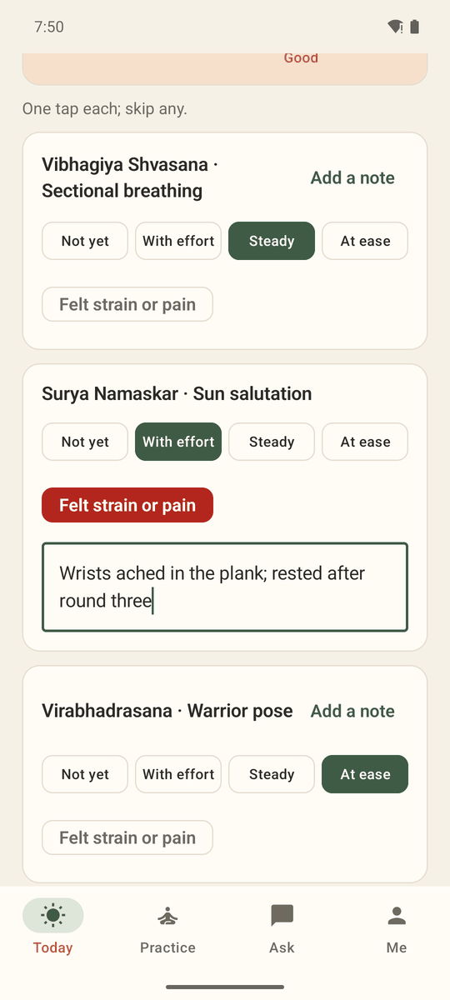
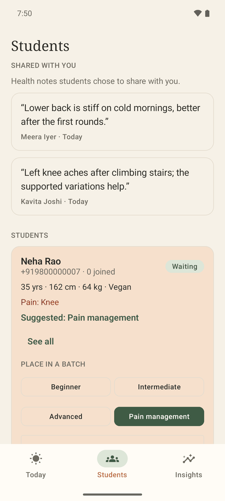
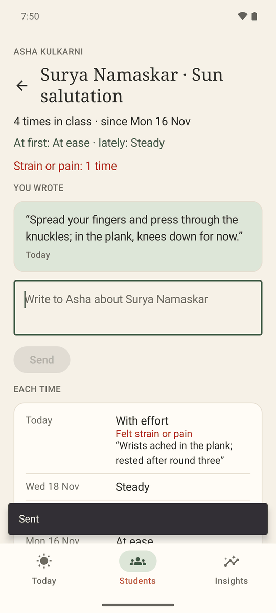
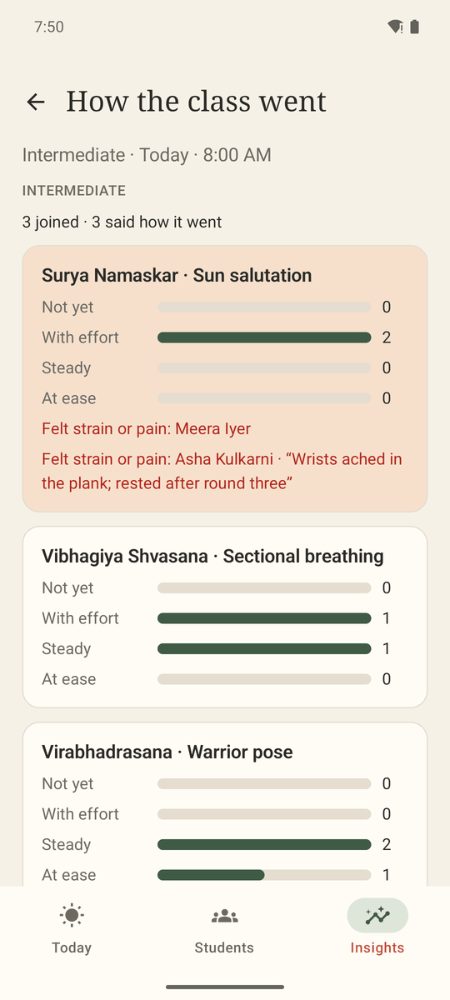
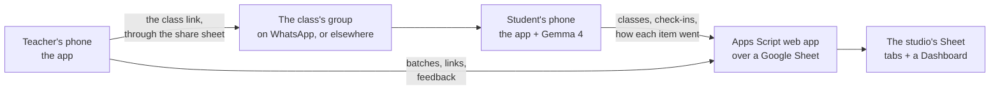

# Satt Chitt Anand

A practice tracker for an online yoga studio: students say how each asana went, in class and on their own, and the
teacher reads it to guide them.

**[Watch the 2:43 film of how it works](https://github.com/DhwaniMundra/satt_chitt_anand_yoga/releases/download/v0.9/release_v1_720p.mp4)**

<!-- Dhwani: your own sentences go here. -->

## The studio

The teacher teaches live on Google Meet, in four batches (Beginner, Intermediate, Advanced and Pain management), each
with its own days, time and link. The class keeps in touch in a WhatsApp group. The app fits around that without
depending on it: the teacher shares each class's link from the app through Android's share sheet, to the group or
anywhere else, and the app keeps what a chat cannot, a record of each student's practice.

## What it does

<p>
  
  
  
  
</p>

**For a student**
- **Joining** takes a phone number and the group code, which the teacher gives with the invite. The student signs up,
  then answers a few questions for the teacher: age, height, weight, food habits, any pain, and how six poses feel. The
  teacher places them in a batch.
- **The Today tab** shows the batch's next class in the student's own time zone, with its sequence and the Meet link.
  After class, the student gives each item one tap (not yet, with effort, steady or at ease), can flag strain or pain,
  and can add a note.
- **The Practice tab** shows how each asana has gone, in class and alone, and what the teacher wrote about it. Solo
  practice has a stopwatch for each item.
- **The Ask tab** is Gemma 4, running on the phone. It answers from the student's own practice and the studio's notes,
  in English, Hindi or Marathi: "How is my Setu Bandhasana going?", "When is my next class?"

<p>
  
  
  
  
</p>

**For the teacher**
- **The Today tab** shows one card per batch, with the class's sequence and its Meet link, saved and shared from there
  to the class's group, or anywhere else.
- **The Students tab** shows a new student's answers and the batch they point to. The teacher approves them into a
  batch, or moves a student later with a note, and can write feedback on any of a student's asanas.
- **The Insights tab** shows mood before and after each class, and how each class went item by item, with strain or pain
  first.

## How it works



- **The backend** is a Google Apps Script web app over a Google Sheet in the studio's Drive: free, with nothing to run,
  and every table a tab the studio can read. ([`appsscript/`](appsscript/README.md))
- **Gemma 4 E2B runs on the phone**, an opt-in download of 2.6 GB. A student's questions and the health notes they keep
  stay on the phone. Its tools hand it only that student's data, with the sums done in code and every average in
  words. A phone with too little memory is told so.

## Careful with health

- Gemma never diagnoses, promises a cure or advises on medicine. Emergency signs get a fixed reply with 112 and
  Tele-MANAS (14416), before any model runs.
- Only the student and the teacher see what a student says about themselves; the Sheet's Dashboard shows it only as
  counts.
- Every answer Gemma gave in the evaluation was read against the data
  ([`companion_v1_phone`](docs/evals/companion_v1_phone.md)). Its Marathi is the weak spot; a Marathi reader checks it.

## How it was made

In rounds, from v0.1 to v1.0, which is out for testing as [v0.9.1](https://github.com/DhwaniMundra/satt_chitt_anand_yoga/releases/tag/v0.9.1). Each round, a script walks through the app on an Android
emulator, and the companion is asked the same questions in three languages. Then every screen and every answer is read,
and what reading finds is fixed, with a test where one fits. One finding of v1.0: Gemma reported an average reaction of
2.0 ("with effort") as "not yet", so the tools now hand it the words, worked out in code.

The record: [iteration log](docs/iterations/README.md) · [evaluations, every answer](docs/evals/) ·
[decisions](docs/decisions.md) · [development](docs/DEVELOPMENT.md).

## Try it

On the laptop that holds the toolchain:

```bash
scripts/demo.sh         # the dev backend on demo data, the 6 GB emulator with Gemma, and the app; demo.sh stop ends it
```

Password `demo123`: the teacher `9800000001`; students `9800000002` to `9800000006` and `9800000008`; `9800000007` is
waiting to be placed. The demo's people and practice are synthetic.

## Credits

Designed and directed by **Dhwani Mundra**: the brief, the product decisions, and every round of critique and changes.
The code, tours and evaluations were written with **Claude Code**, an AI coding agent, working from her direction.
Studio content: Satt Chitt Anand Yoga Classes.
