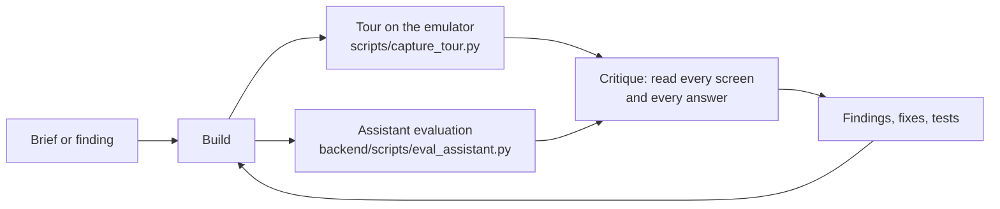

# How we iterate

Every version goes round the same loop, and every round leaves evidence in this folder.

1. **Build** from the brief, or from the last round's findings (including outside reviews).
2. **Tour.** `scripts/capture_tour.py <version>` drives the app on the emulator through the same steps every
   time (sign up and log in, join a class, check in, breathe, ask in English and Hindi, then the teacher's screens)
   and saves screenshots and two screen recordings to `docs/media/<version>/`. The same steps each time make
   versions comparable side by side.
3. **Evaluate the assistant.** `backend/scripts/eval_assistant.py` asks a fixed set of questions in English,
   Hindi and Marathi, runs coarse automatic checks, and writes every answer to `docs/evals/`. The checks only
   catch obvious failures; a person reads every answer.
4. **Critique.** Look at every screenshot and read every answer as a student would. Each problem becomes a finding
   with the image or answer that shows it.
5. **Fix and lock in.** Each fix gets a test where one is possible, so the same problem cannot quietly return
   (for example, every suggested question is tested in all three languages).

Nothing here is user research yet: all people, check-ins and comments in screenshots are **synthetic demo data**.
Testing with real students starts only with their consent (the app asks for it at sign-up).

## Versions

| Version | What changed | Evidence |
|---|---|---|
| [v0.1](v0.1.md) | First build from the brief | `docs/media/v0.1/` |
| [v0.2](v0.2.md) | Fixes from the first tour: log-in switch, Hindi retrieval, sources, time zones | `docs/media/v0.2/`, `docs/evals/assistant_v0.2.md`, `docs/media/figures/` |
| [v0.3](v0.3.md) | Assistant: Marathi answers checked by reading them; a first prompt fix | `docs/evals/assistant_v0.3.md` |
| [v0.4](v0.4.md) | An independent code review (15 fixes); Marathi answers from Marathi notes; two phones against one server | `docs/evals/assistant_v0.4.md`, `docs/evals/marathi_experiments.md`, `docs/media/v0.4/`, `docs/media/v0.4-two-phones/` |

## Who did what

The brief (`instructions.md`, kept private) came from Dhwani Mundra. The code, tours and evaluations in v0.1–v0.4
were produced with Claude Code, an AI coding agent. In v0.4 two further agents
worked from written briefs (a code review, Marathi experiments); their reports were checked before anything was
applied. Product decisions are recorded
in [`../decisions.md`](../decisions.md).
