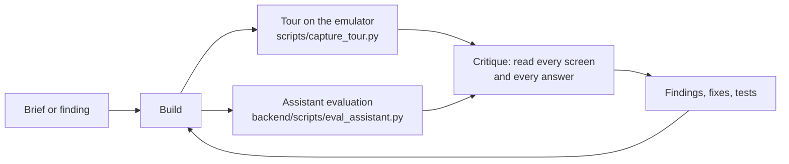

# How we iterate

Every version goes round the same loop, and every round leaves evidence in this folder.

1. **Build** from the brief, or from the last round's findings (including outside reviews).
2. **Tour.** `scripts/capture_tour.py <version>` drives the app on the emulator through the same steps every
   time (sign up and log in, join a class, check in, breathe, ask in English and Hindi, then the teacher's screens)
   and saves screenshots and two screen recordings locally (`.local/visualization/`). `scripts/make_figures.py` turns
   each tour into one contact sheet in [`docs/media/iterations/`](../media/iterations/), so versions can be compared
   side by side.
3. **Evaluate the assistant.** `backend/scripts/eval_assistant.py` asks a fixed set of questions in English,
   Hindi and Marathi, runs coarse automatic checks, and writes every answer to `docs/evals/`. The checks only
   catch obvious failures; a person reads every answer.
4. **Critique.** Look at every screenshot and read every answer as a student would. Each problem becomes a finding
   with the image or answer that shows it.
5. **Fix and lock in.** Each fix gets a test where one is possible, so the same problem cannot quietly return
   (for example, every suggested question is tested in all three languages).

The people, check-ins and comments in the screenshots are demo data.

## Versions

| Version | What changed | Evidence |
|---|---|---|
| [v0.1](v0.1.md) | First build from the brief | [screens](../media/iterations/v0.1.jpg) |
| [v0.2](v0.2.md) | Fixes from the first tour: log-in switch, Hindi retrieval, sources, time zones | [screens](../media/iterations/v0.2.jpg), [`assistant_v0.2`](../evals/assistant_v0.2.md), [before and after](../media/figures/before_after.png) |
| [v0.3](v0.3.md) | Assistant: Marathi answers checked by reading them; a first prompt fix | [`assistant_v0.3`](../evals/assistant_v0.3.md) |
| [v0.4](v0.4.md) | An independent code review (15 fixes); Marathi answers from Marathi notes; two phones against one server; the narrated video; a README for readers | [screens](../media/iterations/v0.4.jpg), [two phones](../media/iterations/v0.4-two-phones.jpg), [`assistant_v0.4`](../evals/assistant_v0.4.md), [`marathi_experiments`](../evals/marathi_experiments.md), [`two_phones_v0.4`](../evals/two_phones_v0.4.md) |

## Who did what

Dhwani Mundra wrote the brief (`instructions.md`, kept private) and directed every round in a Claude Code session:
what to build, what to fix, how the app and the repository should be organised, and what to leave out. Claude Code,
an AI coding agent, wrote the code and ran the tours and evaluations. In v0.4 two further agents worked from written
briefs (a code review, Marathi experiments); their reports were checked before anything was applied. Product
decisions are recorded in [`../decisions.md`](../decisions.md).
