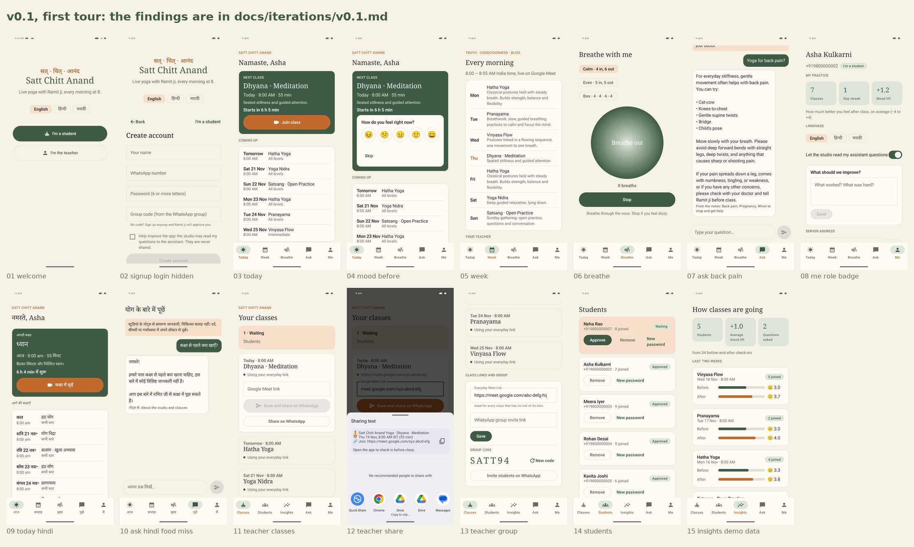

# v0.1: first build from the brief

**Date:** 18 Nov 2026

## The brief, in short

- A yoga app inspired by the studio's site (`satt-chitt-anand-flow.lovable.app`): daily live classes at 8:00 IST
  on Google Meet, seven class types, one teacher.
- WhatsApp: one class group where the teacher shares Google Meet links; the app should "authenticate" to it, or, if
  that is too hacky, use its own server with separate student and teacher logins.
- Gemma 4 (E4B) answers questions about yoga and health, from a notes file written for it.
- Document how the app is iterated, with images and videos.

## What was built

- **Student:** Today (next class, countdown, one-tap join with a mood check-in before and after), Week (the
  weekly rhythm and the teacher), Breathe (a circle that grows and shrinks with three rhythms), Ask (the Gemma
  assistant with suggested questions), Me (practice stats, language, consent, feedback).
- **Teacher:** Classes (paste the Meet link, save and share to WhatsApp; an everyday link; the group code and an
  invite message), Students (approve, remove, reset password), Insights (before-and-after moods, feedback).
- **Languages:** English, Hindi and Marathi throughout.
- **Backend:** accounts, sessions, check-ins, the assistant with an urgent-sign path, backups to a private GitHub
  repository. 29 tests.
- How each WhatsApp and storage question was decided: [`../decisions.md`](../decisions.md).

## What the first tour showed

| # | Finding | Screen (on the sheet above) |
|---|---|---|
| 1 | On the sign-up form, "Log in" was below the fold: a returning student had to scroll past five fields to find it | 02 signup login hidden |
| 2 | Asked in Hindi "what should I eat before class?" (कक्षा से पहले क्या खाएँ?), the assistant found no notes and said it did not know. Hindi inflects the verb (खाएँ), and the notes listed only खाना | 10 ask hindi food miss |
| 3 | "From the notes" listed sections that had nothing to do with the question (Pregnancy under a back-pain answer): every retrieved section was shown, however weak its match | 07 ask back pain |
| 4 | The role badge on Me read "I'm a student" (the button's text), not "Student" | 08 me role badge |
| 5 | On a phone outside India the 8:00 AM IST class showed only in local time (6:30 PM), with no hint of India time | (emulator in Pacific time) |
| 6 | Common Hindi and Marathi words (का, आहे…) counted as matches, pulling up unrelated sections | (retrieval logs) |

The first assistant check, six questions by hand, went well: it refused to approve stopping metformin, said to avoid
Kapalabhati with high blood pressure, answered in Hindi and Marathi, and declined an off-topic question. Two
quality notes: the Hindi answer listed one pose twice, and the Marathi answer had a garbled word. These were
followed up in v0.3.
