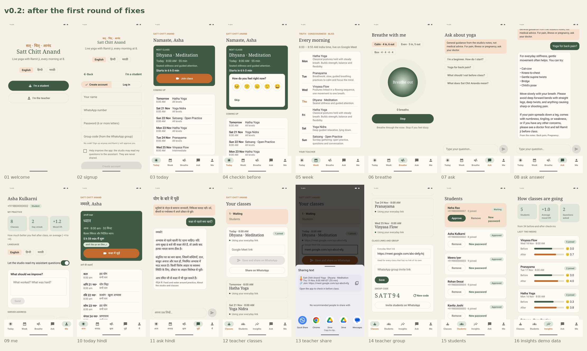

# v0.2: fixes from the first tour

**Date:** 18 Nov 2026

| # | v0.1 finding | Change | How it is checked |
|---|---|---|---|
| 1 | "Log in" hidden below the sign-up form | A two-part switch, "Create account / Log in", above the form; the brand shrinks once a role is picked | Tour screenshot `02_signup`; [figure](../media/figures/signup_v0.1_v0.2.png) |
| 2 | Hindi food question found no notes | Inflected Hindi and Marathi forms added to the notes' keywords; a word the notes lack is matched to the longest note word it starts with (गरोदरपणात → गरोदरपणा) | 12 tests: every suggested question, in all three languages, must find its section; a test checks the app's suggestions are exactly the tested ones. [Figure](../media/figures/ask_hindi_v0.1_v0.2.png) |
| 3 | Unrelated sources listed | Only sections scoring at least 55% of the best match are used and shown | Back-pain answer now cites "Back pain" only (`docs/evals/assistant_v0.3.md`) |
| 4 | Role badge wording | "Student" / "Teacher" in all three languages | Tour screenshot `09_me` |
| 5 | No India time abroad | Times read "7:30 PM · 8:00 AM IST" when the phone is not on India time | Code: `timeLabel` in `ui/Components.kt` |
| 6 | Function words matched | Hindi and Marathi stop words dropped before matching | Test `test_devanagari_words_stay_whole` |

The tour itself became a script (`scripts/capture_tour.py`), so v0.2 and every later version are captured the same
way: 16 screenshots and two recordings, kept locally; all 16 on one sheet:

## The first full assistant evaluation

`docs/evals/assistant_v0.2.md`: 17 fixed questions (9 English, 4 Hindi, 4 Marathi). All 17 passed the automatic
checks. **Reading the answers told a different story for Marathi:**

- `mr-food` said it is good to eat something light *before* class; the notes say practise on an empty stomach.
- `mr-pregnant` said to avoid lying on the *belly* after three months; the notes say the *back*.
- `mr-sleep` got stuck repeating one word until it ran out of length.
- `mr-back` had several garbled words.

English and Hindi answers were faithful to the notes and safe. Lesson recorded for the loop: **a pass on the
automatic checks is not a pass**; every answer is read. This led to v0.3.
