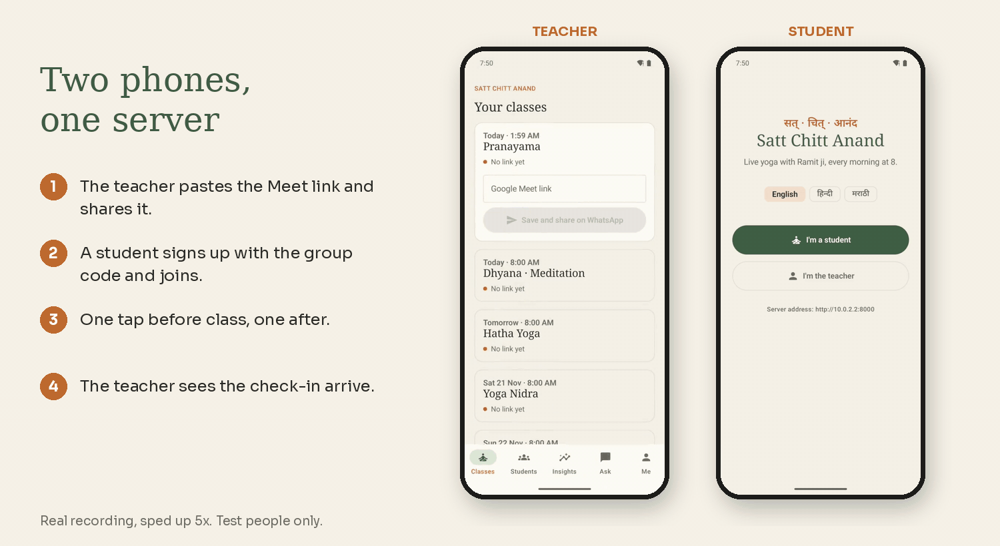
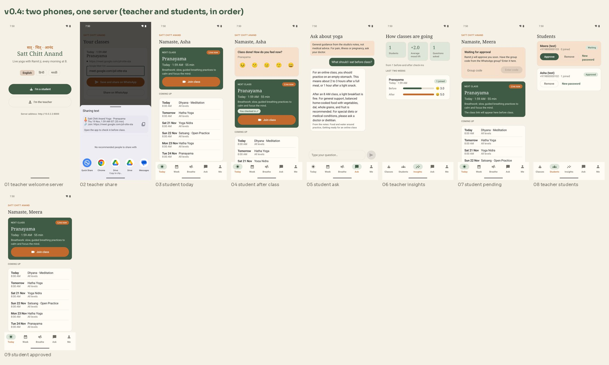
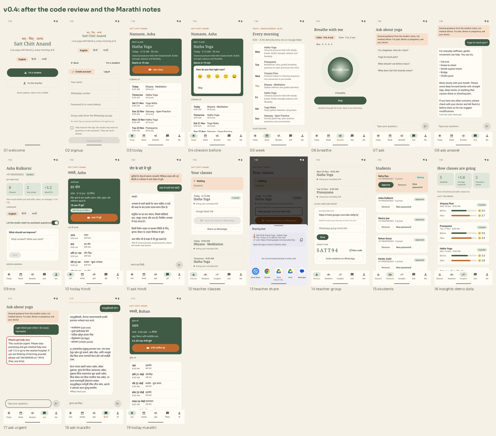

# v0.4: an outside review, Marathi from notes, two phones

**Date:** 18 Nov 2026

Two pieces of work ran side by side, each by a separate AI agent briefed only with the goal and the files. Their
reports were then checked against the code and the answers before anything was applied.

## 1. An independent code review

A reviewer that had not written the code read the backend and the app for defects, and reproduced what it could
with throwaway scripts. 15 findings: 11 confirmed, 4 plausible. All 15 were checked and fixed; two only in part
(noted below).

| # | Finding | Fix |
|---|---|---|
| 1 | Any reply that was not JSON (a server error page, a router page) crashed the app; with a wrong server address saved, on every launch | Such replies become an error message |
| 2 | The server address could only be changed after signing in, so a real phone could never reach the server | Address shown, and editable, on the first screen; can be built in with `-PscaServer` |
| 3 | Restoring a backup over 1 MB would fail (GitHub's API leaves the content out) | Raw and "object" replies, which work up to 100 MB |
| 4 | A backup holding only settings stopped the server from ever starting again | Restore replaces rows already there |
| 5 | Check-ins had no time window: checking in to tomorrow's class reset the streak and hid today's after-class question | "Before" from an hour before class to its end; "after" only once joined, from 10 minutes before the end |
| 6 | Back from Meet, the after-class question did not appear until a manual refresh | The app reloads whenever it comes back to the front |
| 7 | Emergency signs written differently slipped past the fixed reply: "I can’t breathe" (curly apostrophe), "मुझे साँस नहीं आ रही" (chandrabindu), "my chest hurts" | Text normalised (apostrophes, chandrabindu, nukta), signs matched as patterns; 12 tests including ordinary breathing questions that must *not* trigger it |
| 8 | Without consent, the question's words were dropped but its topic and the person were kept (and backed up) | Without consent: no words, no topic, no person. Withdrawing consent erases what it allowed |
| 9 | Many questions waiting for Gemma could stall every other request | At most 4 wait; beyond that "please try again in a minute". *Part:* no per-person rate limit, not needed for one studio |
| 10 | A teacher code set with lowercase letters could never be typed | Codes are case-insensitive |
| 11 | "098765 43210" and "98765 43210" made two accounts | One normalised number however it is typed |
| 12 | Unlimited password and code guessing; the teacher code worked forever | 5 tries per 15 minutes; teacher sign-up closes once the teacher exists. *Part:* no expiry on login tokens yet |
| 13 | Saving a group link without `https://` silently saved nothing | `https://` added; both links checked before either is saved; the error shows next to the settings |
| 14 | Android device backups copied the login token | App backups off |
| 15 | Rotating the phone lost a just-reset password | It survives rotation |

54 → 69 backend tests.

## 2. Marathi answers

v0.3 showed that Gemma 4 E4B, asked to answer in Marathi from English notes, changes facts and garbles words. An
agent tried 14 variants on 19 Marathi questions (15 new ones added to the evaluation), reading every answer
against the notes. Every answer of every variant: [`docs/evals/marathi_experiments.md`](../evals/marathi_experiments.md).

| Approach | Facts changed | Garbled | Median time |
|---|---|---|---|
| v0.3 (answer in Marathi from English notes) | 7, in 5 answers | 13 of 19 answers | 3.2 s |
| Answer in English, then a second call translates | Still wrong: the English was right, the translation step changed it ("belly", "throat" for neck, "a sari" for blanket) | Many | 5.2 s |
| Marathi-only prompt rules | 0 on the 4 originals | The same word loop in 7 of 12 | |
| Decoding settings (repetition penalty, sampling, banning a token) | Answers drift from the notes, adding advice they do not contain | The loop moves elsewhere | |
| **Marathi notes, copied** | **0** | **1 word** | **2.7 s** |

**Adopted:** a Marathi version of the notes ([`backend/knowledge/yoga_health.mr.md`](../../backend/knowledge/yoga_health.mr.md)),
section by section. For a Marathi question Gemma gets the Marathi sections and a rule to answer in their own words,
always keeping the point about the doctor or about stopping. Letters from other scripts are banned in Marathi
answers (a Japanese word had appeared). English and Hindi answers did not change.

Read by hand in [`docs/evals/assistant_v0.4.md`](../evals/assistant_v0.4.md) (34 questions, 34/34 automatic checks):
the pregnancy answer now says to avoid lying flat on the **back** after the first three months, and the
medicine question says not to change or skip any medicine. One word in one answer is still misspelt.

**The catch:** the Marathi notes were drafted by an AI. Gemma now copies them almost word for word, so they must be
read by a Marathi speaker before any student sees them. The words least certain: "चमक मारणारी वेदना" (shooting
pain), "पाणी (द्रव) जाणे" (fluid leaking), "उलटी आसने" (inversions), "कल्पनाचित्रे" (images). Each change to the
English notes now needs the same change in Marathi; a test checks both files have the same sections.

## 3. Two phones, one server

`scripts/two_phone_test.py` runs a teacher on one emulator and students on another against one server, records both
screens side by side, and checks the loop across devices: 10/10 in
[`docs/evals/two_phones_v0.4.md`](../evals/two_phones_v0.4.md). It confirmed fixes 2, 5 and 6 in use:
the address shows before sign-in, the before-class question appears in the window, and the after-class question
appears on coming back from Meet.

## 4. A narrated video

`scripts/make_video.py` makes a three-minute narrated tour to share and ask for feedback
([video](../media/video/satt_chitt_anand_tour_720p.mp4)), following an earlier project's video script: an open
text-to-speech model (Kokoro-82M) reads each line on the laptop and reports when each word starts; scenes last as long
as their lines; captions darken word by word, so it also works muted; a ring marks the part of the screen being
described; and the sound is brought to -16 LUFS. Checked by listening tools rather than ears: Kokoro's planned
pronunciation of the Indian names was printed and corrected ("Satt Chitt Anand", "Ramit ji", "Hatha", "Satsang"), and
the loudness measured (the first cut was -24 LUFS, too quiet; a compressor and a limiter brought it to -16).

Making the README's figures caught a bug in the video: the two-phone scene was meant to play the recording five times
faster, but the speed-up silently did nothing on that file (its timestamps come from joining two recordings), so the
scene showed only the first 18 seconds and never reached the check-in the narration describes. Both scripts now speed
up by sampling frames instead, and the video was re-rendered.

## 5. A README for readers

The first README read like developer notes, with tall phone screenshots in tables. It now leads with the brief and
the design choices, shows the app in landscape strips of phones, a morning with the app drawn as a service blueprint
(`scripts/make_diagrams.py`), and how it was made; setup moved to [`docs/DEVELOPMENT.md`](../DEVELOPMENT.md).
`scripts/preview_readme.py` renders it the way GitHub does, to check before pushing.

## Also

- The tour script adds a class 20 minutes ahead, so the before-class question is captured whatever the hour.
- `scripts/demo.sh` starts everything for a live demo on the laptop (one or two phones).
- "योग" is ignored when matching notes, as "yoga" already was; it had pulled "Yoga Nidra" into every answer.

## Open

- A Marathi speaker reads `yoga_health.mr.md` and the app's Marathi text; a Hindi speaker the Hindi text.
- Login tokens never expire.
- Hosting beyond the laptop, if the app is ever used outside demos.
