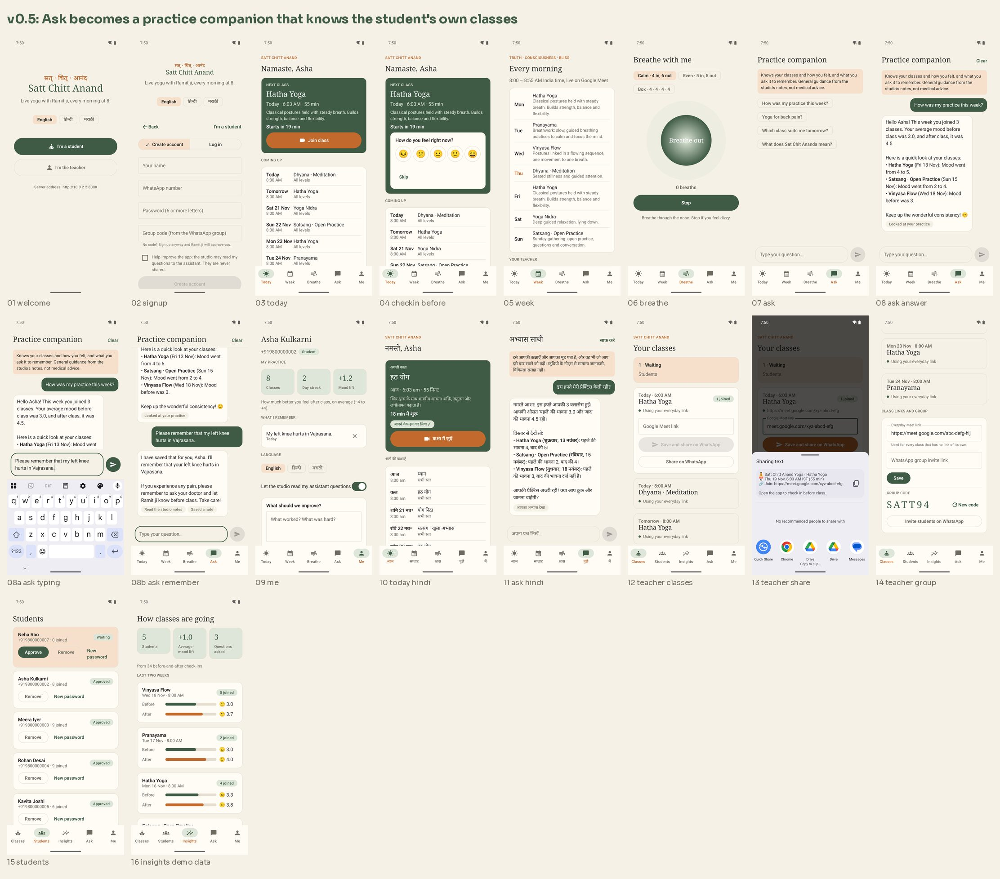

# v0.5: a practice companion

**Date:** 18 Nov 2026

Ask used to answer from the studio's notes only. It is now a chat with Gemma 4 that can look things up for the
student who is signed in: their own classes and how they felt, the coming classes, the studio's notes, and anything
they ask it to remember. "How was my practice this week?" gets the classes they joined and how they felt, not
general advice.

## What was built

Gemma gets five tools (then `backend/sca/companion.py`; on the phone since v0.6, in
[`Companion.kt`](../../android/app/src/main/java/com/sattchittanand/yoga/companion/Companion.kt)). Each is bound to the student
in the conversation, so it can only ever reach that student's data.

| Tool | Returns | Under the reply |
|---|---|---|
| `get_my_practice(days)` | Classes joined, average mood before and after, the same per class, and the classes themselves; the sums done in code | Looked at your practice |
| `get_upcoming_classes()` | The next five classes, each with an unambiguous day ("tomorrow, Friday 20 November") | Checked the schedule |
| `search_studio_notes(query)` | The matching sections of the notes (the Marathi version for Marathi) | Read the studio notes |
| `save_my_note(note)` | Saves something the student asks it to remember | Saved a note |
| `get_my_notes()` | What it has saved | Read your notes |

- The emergency check still runs first, with no model: chest pain gets the fixed reply with 112.
- The server keeps the conversation; each message replays the last six to Gemma, so no chat state lives in memory.
- Ask has Clear. Me has "What I remember", each note with "Forget this".
- Suggestions: "How was my practice this week?", "Yoga for back pain?", "Which class suits me tomorrow?", "What does
  Sat Chit Ananda mean?", in all three languages.
- Without Gemma (or with it off), Ask answers from the notes as before.

## The probe

Before building the chat, a probe gave Gemma 4 E4B tools that returned raw rows (every class, every mood) and eight
questions about a student's practice ([the probe, every answer](../evals/companion_probe.md)). It chose the right tool
all 8 times, but once added up the rows wrongly.
So the tools return summaries worked out in code, and the prompt says to report them as given. In the final runs
below, every number in every reply is in the tools' data.

## E2B or E4B

Both models ran the same 21 conversations (24 turns) on a copy of the demo database, and every answer was read
against the data. Reports, every answer: [E2B](../evals/companion_v0.5_e2b.md), [E4B](../evals/companion_v0.5_e4b.md).

| | Gemma 4 E2B | Gemma 4 E4B |
|---|---|---|
| Model file | 2.6 GB | 3.7 GB |
| Automatic checks | 21/21 | 21/21 |
| Reply time on the laptop's GPU | median 1.2 s, max 2.8 s | median 2.0 s, max 4.2 s |
| Read by hand: facts | Every number, day and time right | Every number, day and time right |
| Read by hand: weaker answers | Marathi "how was my week" is vague, with no numbers; Marathi "which classes are coming" asks which days instead of listing them | In Marathi "how was my week", two lines call the mood before class the mood after |

**Decision:** when Gemma moves onto phones it will be E2B, the smaller file, with the same answers on these
conversations. The laptop server keeps E4B for now, which gives fuller answers in Marathi.

## Findings while evaluating, and fixes

The automatic checks are coarse: an earlier run passed a reply that named the wrong day. Each finding below came
from reading the answers.

| Finding | Fix |
|---|---|
| E2B often answered health questions without searching the notes ("my lower back is stiff") | The notes section the message names is handed to Gemma up front, with the instruction to answer from it |
| Handed over on any match, notes came with unrelated questions: "How many classes did I join in the last 30 days?" got "Stress, anxiety and sleep" (matched on "many" and "last"), and the reply said "Read the studio notes" | A section is handed over only when the message names its topic, with a word of its title or Keywords line. "metformin" and "insulin" were added to the Diabetes keywords, so that question gets "do not change or skip any medicine" |
| Asked about the schedule in Marathi, both models asked what the student meant instead of checking; E4B gave the wrong day for "tomorrow" when it read the dates itself | When the message is about classes, the coming classes are handed over up front with today's date, and every day is unambiguous: "tomorrow, Friday 20 November" |
| With the schedule handed over, "कल कौन सी कक्षा है?" also brought "About the studio and classes" (the word कक्षा is one of its keywords), and E2B answered with today's class | A class word does not count as naming a notes topic when the schedule is already there |
| The evaluation built its own prompt, so it did not see the up-front notes and schedule the app was sending | One `Companion.prompt()`, used by the app and the evaluation. The evaluation also got stricter: a "tomorrow" answer must name tomorrow's class and no other weekday; the app's suggestions are asked word for word |
| E2B wrote a time as "8:০০", in Bengali digits, in a Marathi answer | See below |
| On the tour, asked "Please remember that my left knee hurts in Vajrasana." after the practice question, E4B replied "I have saved that for you" without saving anything (the database had no note). The evaluation had only asked it as a first message | When a message starts with the words the app teaches ("Remember that…", "याद रखना कि…", "लक्षात ठेवा की…") and Gemma did not save it, the app saves it. The tour's conversation is now an evaluation case; the report marks such a save "by the app" |

**The Bengali digits.** Banning digits from other scripts, as letters already were, turned "8:০০" into "८:०७", a
wrong time. The cause was elsewhere: Gemma may not repeat any 8-token sequence (the v0.3 fix for a word loop). The
answer named two classes, and "नोव्हेंबर रोजी सकाळी ८:००" ("November, in the morning, 8:00") is exactly 8 tokens, so
on the second class the right "००" was forbidden and Gemma reached for a look-alike. In the chat, the repeat ban now
looks back only 16 tokens: a word loop is still stopped, and a list can say "8:00" on every line. Digits of other
scripts stay banned in Marathi, and two questions that list the week and a loop check were added to the evaluation.

## Privacy

- A student's chat and the notes the companion saves are theirs. Only they can read them; the teacher's screens do not
  show them; they are not in the studio's GitHub backup. Clear and "Forget this" delete them.
- What the studio keeps of a chat message is what it kept of an Ask question: with the research consent, the words and
  what the reply looked at; without it, only that a message was sent and in which language.
- Gemma runs on the laptop, so nothing goes to an outside AI service.

## The tour

The tour now asks the practice question from its suggestion, types "Please remember that my left knee hurts in
Vajrasana.", shows it under "What I remember" on Me, and asks the practice question again in Hindi. Every screen was
looked at:

| Finding | Fix |
|---|---|
| While typing, the question box and Send were hidden behind the keyboard: the app draws edge to edge, so `adjustResize` no longer shrinks the screen, and only the welcome screen made room for the keyboard. Earlier tours only tapped suggestions, so they never typed in Ask | The main screens end above the keyboard (which also helps the feedback box on Me and the teacher's Meet link field); the tour shows the box above the keyboard (`08a_ask_typing`) |
| "I have saved that for you" with nothing saved | In the table above |
| The server keeps the chat, so the old tour's way back to the suggestions (restart the app, which emptied the chat) no longer works | The tour taps Clear (साफ़ करें) before the Hindi question, and starts each run with no chat and no notes for the demo student, so a second run shows the same screens |

Seen and left for later: the Hindi and Marathi Today card shows the English "min" ("18 min में शुरू", older than
v0.5), and Hindi and Marathi answers often name classes in English ("Hatha Yoga"), because the tools give the English
names.

## Open

- A Hindi and a Marathi speaker read the new text, and the companion's Hindi and Marathi answers.
- Gemma on the phone (E2B) is decided, not built.
- The two weaker Marathi answers from E2B.
- A note asked for in other words ("Can you note that…") is saved only if Gemma calls the tool; the label under the
  reply shows whether it did.
